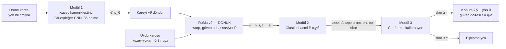
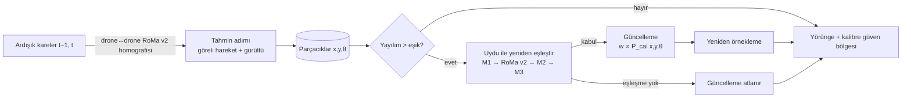
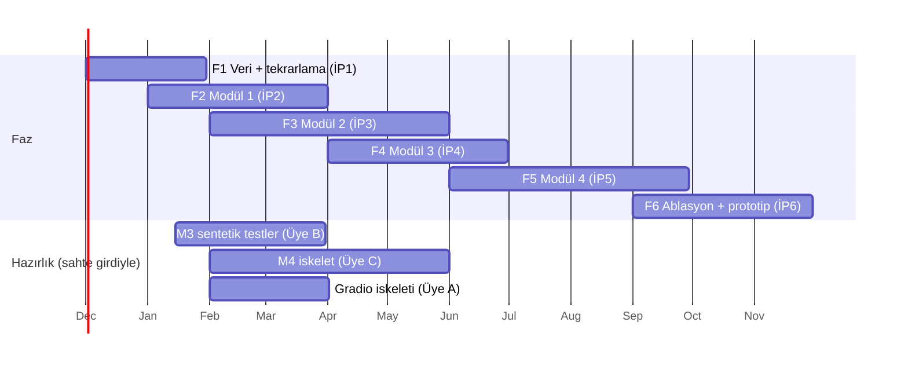

# GüvenLoc — Mimari ve Faz Faz Uygulama Planı

> Kaynak: 2209-A araştırma önerisi (rapor değişmeyecek; bu belge raporun uygulama planıdır).
> Başlangıç: 23 Kasım 2026 (Gün 1). "Ay 1" = Aralık 2026 kabul edilmiştir.
> Belge sahibi: Efsun Boz (koordinasyon). Değişiklikler PR ile yapılır.

---

## İçindekiler

1. [Sistemin genel mimarisi](#1-sistemin-genel-mimarisi)
2. [Depo yapısı ve kod modülleri](#2-depo-yapısı-ve-kod-modülleri)
3. [Ortak kurallar (her fazda geçerli)](#3-ortak-kurallar-her-fazda-geçerli)
4. [Faz özeti ve takvim](#4-faz-özeti-ve-takvim)
5. [Faz 0 — Altyapı (TAMAM) ve devreden işler](#faz-0--altyapı-tamam-ve-devreden-işler)
6. [Faz 1 — Veri, tekrarlama, önbellek, taban çizgileri (İP1)](#faz-1--veri-tekrarlama-önbellek-taban-çizgileri-ip1-ay-12)
7. [Faz 2 — Modül 1: Kuzey kanonikleştirici (İP2)](#faz-2--modül-1-kuzey-kanonikleştirici-ip2-ay-24)
8. [Faz 3 — Modül 2: Olasılık hacmi (İP3)](#faz-3--modül-2-olasılık-hacmi-ip3-ay-36)
9. [Faz 4 — Modül 3: Conformal kalibrasyon (İP4)](#faz-4--modül-3-conformal-kalibrasyon-ip4-ay-57)
10. [Faz 5 — Modül 4: Zamansal füzyon (İP5)](#faz-5--modül-4-zamansal-füzyon-ip5-ay-710)
11. [Faz 6 — Ablasyon, hız ölçümü, prototip, açık kaynak (İP6)](#faz-6--ablasyon-hız-ölçümü-prototip-açık-kaynak-ip6-ay-1012)
12. [Paralel yayın hattı](#12-paralel-yayın-hattı)
13. [Risk ve B planları (fazlara bağlı)](#13-risk-ve-b-planları-fazlara-bağlı)
14. [Ekler: formüller, metrik tanımları, config şablonu](#14-ekler)

---

## 1. Sistemin genel mimarisi

### 1.1 Çıkarım (inference) akışı — tek kare



### 1.2 Zamansal akış — ardışık kareler (Modül 4)



### 1.3 Temel tasarım ilkeleri

| İlke | Uygulamadaki karşılığı |
|---|---|
| RoMa v2 donuktur | Hiçbir ağırlığı güncellenmez; yalnızca çıkarım. Sürüm sabit: `romav2==2.0.1`. |
| RoMa v2 bir kez hesaplanır | Tüm çiftler × 4 yön sunucuda önbelleğe alınır; M1–M4 geliştirme önbellekten okur. |
| Bölge ayrık protokol | 11 bölge: 6 eğitim / 2 kalibrasyon / 3 test. Bir bölgenin kareleri tek kümededir. |
| Test bölgelerine dokunulmaz | Her eşik/hiperparametre eğitim veya kalibrasyon bölgelerinde seçilir. Test yalnızca `scripts/final_eval.py` ile koşulur. |
| Modüller arayüzle konuşur | Biçimler `INTERFACES.md`'de; her modül sahte girdiyle bağımsız geliştirilebilir. |
| Her sayı yeniden üretilebilir | Her koşu: config + seed + git commit → `results/runs.csv` satırı. |

---

## 2. Depo yapısı ve kod modülleri

```
guvenloc/
├── configs/
│   ├── base.yaml              # yollar, seed, cihaz, RoMa ayarı
│   ├── split.yaml             # bölge ayrımı 5/2/3 (07 dışarıda) — DONDURULMUŞ
│   ├── pairs.yaml             # karo boyutu, kaydırma, negatif üretimi
│   ├── m1.yaml m2.yaml m3.yaml m4.yaml
├── guvenloc/
│   ├── io_visloc.py           # UAV-VisLoc CSV + uydu tif okuyucu
│   ├── geo.py                 # piksel ↔ enlem/boylam ↔ metre, karo kesme, ölçek s
│   ├── pairs.py               # pozitif / zor negatif / kolay negatif üretimi
│   ├── matcher.py             # RoMa v2 sarmalayıcı (+ sample() hata düzeltmesi, Σ dönüşümü)
│   ├── cache.py               # npz önbellek okuma/yazma, şema doğrulama
│   ├── baselines.py           # RANSAC homografi, 4 yön + inlier, 4 yön + entropi
│   ├── m1_canon.py            # Modül 1 ağı + çıkarım
│   ├── m2_volume.py           # Modül 2 oylama hacmi + metrikler + 3B inceltici
│   ├── m3_conformal.py        # Modül 3 τ ve q̂ hesapları (+ Mondrian)
│   ├── m4_filter.py           # Modül 4 parçacık filtresi
│   ├── pipeline.py            # uçtan uca: kare → karar çıktısı
│   ├── metrics.py             # başarı@k, medyan hata, AUROC, kapsama, yanlış kabul
│   └── stats.py               # küme bootstrap, McNemar, Wilcoxon, Holm, Clopper–Pearson
├── scripts/                   # 00_…, 01_… numaralı, her biri tek komutluk deney
├── tests/                     # pytest: geo gidiş-dönüş, M1 eşdeğerlik, M3 kapsama, şema
├── app/                       # Gradio prototipi
├── docs/                      # bu belge, faz raporları, yöntem paragrafları
├── data/  cache/  results/    # git dışı (results/runs.csv hariç)
├── INTERFACES.md  README.md  requirements.txt  requirements.lock.txt
```

---

## 3. Ortak kurallar (her fazda geçerli)

### 3.1 Git ve kod inceleme
- `main` her zaman çalışır. Herkes `faz<N>/<kısa-ad>` dalı açar.
- **Tek geliştirici (25.11'den itibaren):** bütün iş tek kişi tarafından, sunucuda yapılır. PR'lar kayıt için açılır;
  CI yeşilse geliştirici birleştirir, ikinci kişi incelemesi aranmaz. Arayüz (`INTERFACES.md`), `split.yaml` ve
  arazi etiketi değişiklikleri PR açıklamasına gerekçesiyle yazılır. §3.4'teki roller proje önerisindeki resmî
  görev dağılımıdır; uygulamada iş akışını bağlamaz.
- CI (GitHub Actions, CPU): `ruff` biçim denetimi + `pytest -m "not gpu"`.
- Sihirli sayı yok: her sabit `configs/` altında.

### 3.2 Deney kaydı
Her betik sonunda `guvenloc.metrics.log_run()` çağırır → `results/runs.csv`:
`timestamp, script, config_hash, seed, git_commit, split, metric_name, value, notes`

### 3.3 Veri ve önbellek
- Veri ve önbellek için `sha256sum` listesi `docs/checksums/` altında tutulur.
- Önbelleği yalnızca Üye B üretir ve sürümler (`cache/v1/`, `cache/v2/`…). Önbellek sunucuda durur;
  ekip ona SSH ile sunucuda erişir, kopyalanmaz.
- Bütün GPU işleri (önbellek, eğitim, değerlendirme, hız ölçümü) üniversite sunucusunda (RTX 3090 24 GB) yapılır.

### 3.4 Roller

| Kişi | Birincil | İkinci sorumlu olduğu | Resmî İP |
|---|---|---|---|
| Üye A | Veri hattı + platform (`io_visloc`, `geo`, `pairs`, `metrics`, `stats`, Gradio) | M2 | İP6 |
| Üye B | RoMa tekrarı, `matcher`, önbellek → M3 | M1 | İP1, İP4, İP6 |
| Üye C | Tekrarlama, taban çizgileri → M4 | M3 | İP1, İP5 |
| Efsun | M1 → M2, koordinasyon, entegrasyon | M4 | İP2, İP3, İP5 |

### 3.5 Toplantı ritmi
- Haftalık 1 saat demo toplantısı (herkes ekranda sonucunu gösterir).
- Haftada iki asenkron durum notu: *ne bitti / ne engel / sırada ne*.
- İki haftada bir danışman toplantısı + tek sayfalık güncel tablo.
- Her faz sonunda **entegrasyon haftası**: yeni özellik yok, yalnızca birleştirme ve onarım.

---

## 4. Faz özeti ve takvim

| Faz | İP | Ay | Takvim (yaklaşık) | Sürüm etiketi | Ablasyon satırı |
|---|---|---|---|---|---|
| 0 Altyapı | – | Gün 1 | 23 Kas 2026 | – | – |
| 1 Veri + tekrarlama + taban çizgisi | İP1 | 1–2 | Ara 2026 – Oca 2027 | v0.0 | 1, 2, 3 |
| 2 Modül 1 | İP2 | 2–4 | Oca – Mar 2027 | v0.1 | 4 |
| 3 Modül 2 | İP3 | 3–6 | Şub – May 2027 | v0.2 (ay 4) | 5 |
| 4 Modül 3 | İP4 | 5–7 | Nis – Haz 2027 | v0.3 (ay 7) | 6 |
| 5 Modül 4 | İP5 | 7–10 | Haz – Eyl 2027 | v0.4 (ay 10) | 7 |
| 6 Ablasyon + prototip | İP6 | 10–12 | Eyl – Kas 2027 | v1.0 | tamamı |



---

## Faz 0 — Altyapı (TAMAM) ve devreden işler

### Çalışma ortamı (25 Kasım 2026'dan itibaren)
**Bütün GPU işleri üniversite sunucusunda yapılır:** RTX 3090 24 GB (sm_86), Ubuntu 22.04, Python 3.12,
torch 2.11.0+cu128, romav2 2.0.1. Veri (`data/`), önbellek (`cache/v1/`) ve sonuçlar (`results/`) yalnızca
burada durur; diğer makinelere kopyalanmaz. **Bütün iş bu makinede, makinenin başında yapılır; uzaktan
erişim (SSH) kullanılmaz.** 23–24 Kasım'daki işler (Faz 0 Gün 1, Faz 1'in ilk kısmı) RTX 5060/5050
dizüstünde ve Kaggle T4'te yapıldı; o sayılar belgelerde kendi donanımıyla birlikte kayıtlı kalır.

### Tamamlananlar (Gün 1, 23 Kasım 2026)
- `.venv`: Python 3.12.10, torch 2.11.0+cu128, romav2 2.0.1 (Windows'ta doğrudan çalışıyor).
- Depo iskeleti, `README.md`, `INTERFACES.md` (taslak), `requirements*.txt`, `.gitignore`.
- `scripts/00_check_env.py`, `scripts/01_roma_single_pair.py`.
- Ölçümler (RTX 5060 Laptop 8 GB): `precise` 10,4 GB / 3,7 s; `mega1500` 7,1 GB / 2,1 s; `base` 3,4 GB / 0,31 s.
- Bulgular: WxBS = v1.1 (paket içi `benchmarks/wxbs.py`); tek yönlü ayarlarda `sample()` hassasiyet hatası.

### Sunucu kurulumu (25 Kasım 2026)
- `00_check_env.py`: RTX 3090, 25,4 GB, sm_86; matmul ve bf16 doğru.
- `01_roma_single_pair.py --setting mega1500`: 0,54 s/çift, 7,13 GB, köşe hatası **0,32 px**, eşleşme hatası medyan
  0,32 px (dizüstüyle aynı) → `results/day1/report.json`.
- `pytest`: 70 geçti (GPU testleri dahil), 1 atlandı (önbellek henüz yok).

### Devreden işler

| # | İş | Sorumlu | Bitti sayılır |
|---|---|---|---|
| 0.1 | ~~Diğer 3 makinede kurulum~~ → sunucuda kurulum + `01_roma_single_pair.py --setting mega1500` | Üye B | **✅ 25.11:** sunucuda köşe hatası 0,32 px. Diğer makinelerde GPU kurulumu gerekmiyor (bütün GPU işleri sunucuda); donanımdan bağımsızlık dizüstü (5060), Kaggle T4 ve 3090 ile gösterildi |
| 0.2 | GitHub deposu, ilk commit, ekip üyeleri eklendi | Efsun | **✅** dört hesabın push yetkisi var |
| 0.3 | Üniversite GPU sunucusu erişimi | Üye C | **✅ 25.11:** sunucu = bu makine, `00_check_env.py` koştu. SSH gerekmiyor (bütün iş makinenin başında yapılır) |
| 0.4 | **Hassasiyet biriminin çözülmesi** (bkz. INTERFACES.md açık soru) | Üye B | `matcher.py` Σ'yı piksel biriminde döndürüyor; sentetik çiftte σ ile gerçek hata aynı mertebede — **✅ Faz 1'de çözüldü:** P son refiner aşamasının ızgara pikselinde (`docs/faz1_matcher_onbellek.md`) |
| 0.5 | CI kurulumu (ruff + pytest) | Üye A | **✅** PR'larda ruff + `pytest -m "not gpu"` |

**0.4 için yöntem:** `romav2/geometry.py::prec_mat_from_prec_params` ve `RoMaV2.prec_map_coordinates` okunur. Hassasiyetin tanımlandığı koordinat sistemi (normalize mi, `anchor_width=512` ölçeğinde piksel mi, çıkış çözünürlüğünde piksel mi) belirlenir. Doğrulama: sentetik çiftte gerçek hatalar `e_i` için `e_iᵀ P_i e_i` dağılımı ~χ²(2) civarında olmalı (tam kalibrasyon beklenmez, mertebe tutmalı).

---

## Faz 1 — Veri, tekrarlama, önbellek, taban çizgileri (İP1, Ay 1–2)

**Hedef 1:** RoMa v2'yi ±1 puan içinde tekrarlamak; UAV-VisLoc'ta bölge ayrık protokolü ve taban çizgilerini kurmak.
**Resmî sorumlular:** Üye B, Üye C. **Fiilen:** veri hattı Üye A, çift üretiminde Efsun destek.
**Çıktı:** `v0.0` etiketi — tekrarlama tablosu + taban çizgisi tablosu tek komutla üretilir.

### 1A. Veri indirme ve doğrulama (Hafta 1) — Üye A

| Veri | Kaynak | Hedef klasör | Not |
|---|---|---|---|
| UAV-VisLoc örnek (2,04 GB) | GitHub `IntelliSensing/UAV-VisLoc` README | `data/uav_visloc_sample/` | Yalnızca 03 klasörü; geliştirme için |
| UAV-VisLoc tam (16,4 GB) | Aynı README, Google Drive | `data/uav_visloc/` | Sunucuya bir kez konur, yalnızca orada durur. Zenodo'daki 197 GB sürüm **değil** |
| MegaDepth-1500 test | `romav2` deposu `scripts/eval_prep.sh` (yalnızca MegaDepth satırları) veya LoFTR bölmesi | `data/megadepth/` | ScanNet indirilmez |
| WxBS v1.1 | `romav2.benchmarks.wxbs` otomatik indirir (`wxbs_benchmark` paketi gerekir) | `data/WxBS/` | 32 çift (test alt kümesi; Faz 1'de sayıldı) |
| MegaDepth-C4 | İndirilmez, kodla türetilir (1D) | – | – |

Betikler:
- `scripts/10_download_data.ps1` / `.sh` — indirme komutları (gdown, wget).
- `scripts/11_verify_data.py` — kontroller:
  - UAV-VisLoc: **6.742** drone karesi, **11** uydu haritası, her bölgede CSV var.
  - CSV sütunlarının listesi yazdırılır; enlem, boylam, irtifa, yön (Phi) sütunlarının adı ve **hangi bölgelerde boş olduğu** raporlanır (rapora göre Phi iki bölgede yok — Yunnan, Shandan; doğrulanacak). **Faz 1 bulgusu:** tam pakette Phi yalnızca 07'de (Donghuayuan) yok; Yunnan ve Shandan'da tam dolu. Toplam kare 6.774 (6.742 değil); 09'un haritası 4 parça (`docs/faz1_veri_notlari.md`).
  - Her dosyanın sha256'sı → `docs/checksums/uav_visloc.sha256`.

**Bitti sayılır:** sunucuda `11_verify_data.py` dizüstündeki doğrulamayla aynı sayıları ve aynı checksum'ları veriyor (`docs/checksums/`).

### 1B. Coğrafi altyapı: `io_visloc.py`, `geo.py` (Hafta 1–2) — Üye A

Fonksiyonlar:
```python
load_region(region_id) -> Region            # drone CSV, uydu tif yolu, harita sınırları
latlon_to_sat_px(region, lat, lon) -> (x, y)
sat_px_to_latlon(region, x, y) -> (lat, lon)
meters_per_px(region) -> float              # ≈ 0,3; enleme göre doğrulanır
crop_tile(region, cx, cy, size_px, rot=0) -> (img, tile_origin)
drone_scale(frame) -> s                     # drone px → uydu px ölçek oranı
heading_to_north_angle(frame) -> φ          # kareyi kuzeye hizalayan açı
```

Ayrıntılar:
- Uydu haritasının coğrafi referansı: `satellite_coordinates_range.csv` (sol üst / sağ alt enlem-boylam) ve/veya tif'in kendi georeferansı (`rasterio`). İkisi karşılaştırılır.
- Büyük tif'ler belleğe tümüyle yüklenmez; `rasterio` pencere okuma kullanılır.
- **Ölçek s:** `s = GSD_drone / GSD_uydu`, `GSD_drone = irtifa × piksel_boyutu / odak_uzaklığı`. Kamera iç parametreleri veri setinde/makalede yoksa: eğitim bölgelerinde RoMa v2 homografisinden ölçülen ölçek, irtifaya karşı doğrusal regresyonla bağlanır (`s = k · irtifa`) ve `configs/pairs.yaml`'a yazılır. **Faz 1 bulgusu:** EXIF yok; RoMa ile ölçüldü: ayak izi genişliği = 0,980 × AGL. `height` 05/06/10/11'de deniz seviyesine göre → bölge başına zemin yüksekliği (`ground_elevation_m`) çıkarılır. Phi1 = görüntü üst kenarının pusula yönü (saat yönü).
- **Sağlama (en kritik adım):** `scripts/12_overlay_check.py` her bölgeden 2–3, toplam 20–30 kareyi gerçek konum, ölçek ve yönle uydu haritasına bindirir → `results/overlay/*.jpg`. Yön sütununun işareti (saat yönü mü), referansı (kuzey mi) ve birimi (derece mi) burada kesinleşir ve `geo.py` docstring'ine yazılır.

Testler (`tests/test_geo.py`): enlem/boylam → piksel → enlem/boylam gidiş-dönüş hatası < 1 cm; karo kesme sınır durumları.

**Bitti sayılır:** bindirmeler gözle kontrol edildi; testler yeşil.

### 1C. Bölge ayrımı ve çift üretimi: `pairs.py` (Hafta 2–3) — Üye A + Efsun

**`configs/split.yaml` (dondurulur):**
```yaml
train: [6 bölge]            # yön etiketli
calib: [Yunnan, Shandan]    # yön etiketi yok → M1 eğitiminde kullanılmaz
test:  [tarım, kent, dağlık] # yön etiketli, farklı arazi türleri
# Faz 1'de uygulanan (configs/split.yaml v1): train [01, 04, 08, 09, 10] | calib [05, 11] |
# test [02, 03, 06]; 07 kullanılamaz (30 kare, yön yok) → 5/2/3. 08+09 aynı bölge (Huzhou-3),
# aynı kümede. Calib'de yön etiketi aslında VAR; yine de M1 eğitiminde kullanılmaz.
terrain: {bölge_id: tarım|kent|dağlık, ...}   # Mondrian ve kırılımlar için
```
Arazi türü etiketleri bindirme görsellerine bakılarak verilir. Dosya bir kez yazılır; değişirse gerekçesi PR'a ve `runs.csv` notuna yazılır.

**Çift türleri:**

| Tür | Üretim | Amaç |
|---|---|---|
| Pozitif | Gerçek konum etrafında, merkezi rastgele kaydırılmış uydu karosu | Konum kestirimi |
| Zor negatif | Aynı bölgede gerçek konumdan uzak (≥ karo boyutu × 2) karo | Benzer arazide yanlış kilitlenme |
| Kolay negatif | Başka bölgeden karo | Tamamen ilgisiz sahne |

**Karar verilecek parametreler (`configs/pairs.yaml`):**
- `tile_offset_m`: karo merkezinin gerçek konumdan en fazla kaydırılması (ör. ±200 m) — "GNSS kesildiğinde son bilinen konum + IMU sapması" varsayımını temsil eder. Danışmanla belirlenir.
- `tile_size_m`: drone karesinin en yüksek irtifadaki yer izi + 2 × kaydırma payını kapsayacak boyut.
- Negatif oranı: pozitif başına 1 zor + 1 kolay.
- `seed`: sabit.

Çıktı: `data/pairs/pairs_v1.csv` — şema `INTERFACES.md §2`. Açık kaynak paylaşılacak olan bu dosyadır (görüntüler değil).

**Bitti sayılır:** CSV üretildi; her satırdan rastgele 50 tanesi görsel kontrol edildi; aynı seed ile yeniden üretim birebir aynı.

### 1D. RoMa v2 tekrarlama (Hafta 1–4) — Üye B, Üye C

| Kıyas | Betik | Ayar | Hedef |
|---|---|---|---|
| MegaDepth-1500 | `romav2.benchmarks.mega1500` sarmalayan `scripts/20_repro_mega1500.py` | `mega1500` | AUC@5/10/20 = 62,8 / 77,0 / 86,6 ± 1 |
| WxBS v1.1 | `romav2.benchmarks.wxbs` sarmalayan `scripts/21_repro_wxbs.py` | `wxbs` | mAA@10px = 55,4 ± 1 |
| MegaDepth-C4 | `scripts/22_repro_c4.py` | `mega1500` | AUC@5 düşüşünün gösterilmesi (rapor: 60,02 → 53,45, Ge vd. 2026, 576×576; bizim mega1500: 62,98 → 58,94) |
| Hız/bellek | `scripts/23_speed.py` | `mega1500`, `base` | Kendi kartımızda ms/çift, GB |

- Ağır koşular sunucuda (8 GB'ta `precise` sığmıyor; `mega1500` 7,1 GB sınırda). **Faz 1 bulgusu:** bu tepenin kaynağı romav2 `sample()`'ın KDE'si; `matcher.balanced_sample` ile mega1500 7,3 GB / 4,4 s (RTX 5050). WxBS ±1 içinde tekrarlandı (55,91); `docs/faz1_tekrarlama.md`.
- **C4 türetimi:** i. çiftin ikinci görüntüsü `(i mod 4)·90°` döndürülür; GT pozu ve iç parametre matrisi K **aynı dönmeyle** güncellenir (rot90 için K'da fx↔fy, cx/cy yer değiştirir; R'ye z ekseni etrafında dönme eklenir). Kontrol: 0° çiftlerde sonuç orijinalle birebir aynı olmalı.
- Sapma > 1 puan olursa: çözünürlük, RANSAC eşiği, sürüm, rastgelelik (5 seed) raporlanır; karşılaştırmalar kendi tekrarımıza göre yapılır (rapordaki B planı).

**Bitti sayılır:** `docs/faz1_tekrarlama.md` tablosu + `results/runs.csv` satırları.

### 1E. `matcher.py` ve önbellek (Hafta 3–6) — Üye B

`matcher.py`:
```python
class Matcher:
    def __init__(self, setting="mega1500"): ...
    def match(self, img_drone, img_sat, rot_deg=0, n=10_000) -> MatchSet
        # MatchSet: u, v (piksel), c, Sigma_A, Sigma_B (PİKSEL biriminde), meta
```
- `sample()` hatasının düzeltmesi içeride (Faz 0 bulgusu).
- Σ dönüşümü Faz 0.4'te çözülen yöntemle.
- `rot_deg ∈ {0, 90, 180, 270}`: drone karesi döndürülür, `u` koordinatları **orijinal kare** koordinatlarına geri çevrilerek saklanır.

Önbellek (`scripts/30_build_cache.py`, sunucuda):
- Her çift × 4 yön × ~10.000 eşleşme, fp16, `cache/v1/<pair_id>_r<rot>.npz`.
- Ek olarak Modül 4 için: aynı uçuştaki ardışık drone kareleri arası eşleşmeler `cache/v1/seq/<flight>_<t>_<t+1>.npz`.
- Kaba boyut: ~6.742 kare × 3 çift × 4 yön ≈ 81 bin dosya × ~150 KB ≈ 12 GB.
- Yeniden başlatılabilir (var olan dosyayı atlar), `cache/v1/MANIFEST.csv` + sha256.
- `tests/test_cache_schema.py`: rastgele 100 dosyada şema doğrulama.

**Bitti sayılır:** manifest tam; şema testi yeşil; önbellek diğer üyelere dağıtıldı.

### 1F. Metrikler, istatistik ve taban çizgileri (Hafta 4–8) — Üye C (taban), Üye A (metrik)

`metrics.py`:
- Konum hatası (m): tahmin edilen drone merkezi ile GT arasındaki mesafe (`geo.meters_per_px` ile).
- `success_at(k)` k ∈ {10, 25, 50} m; medyan hata.
- Ret metrikleri: AUROC (pozitif "doğru konum" vs. negatif + yanlış konum), yanlış kabul oranı (FAR).
- Kalibrasyon: kapsama oranı, ortalama güven dairesi yarıçapı.
- Kırılımlar: yön (45°'lik dilimler), irtifa (400–800 / 800–1200 / 1200–2000 m), arazi türü.

`stats.py`: uçuş (küme) bazlı bootstrap GA (B = 2000), McNemar, Wilcoxon işaretli sıra, Holm düzeltmesi, Clopper–Pearson.

`baselines.py` — **ablasyon satırları 1–3:**

| Satır | Yöntem | Konum kararı | Ret kararı |
|---|---|---|---|
| 1 | RoMa v2 (0° yön) + kovaryans ağırlıklı RANSAC homografi | Drone kare merkezi H ile haritaya | inlier sayısı ≥ eşik |
| 2 | 4 yön + en çok inlier | En çok inlier'lı yönün H'si | aynı |
| 3 | 4 yön + en düşük entropi [14] | En düşük eşleşme entropili yön | aynı |

- Kovaryans ağırlığı: RANSAC sonrası yeniden kestirimde (IRLS) `w_i = c_i / tr(Σ_i)`; RANSAC eşiği ve inlier eşiği **eğitim bölgelerinde** seçilir.
- Satır 1'de drone yönü bilinmediği için yön farkı büyük karelerde başarısızlık beklenir — bu H1'in motivasyonudur.

**Faz 1 bitti sayılır (Hedef 1):** tekrarlama tablosu ±1 puan (veya sapma açıklaması); UAV-VisLoc kalibrasyon bölgelerinde satır 1–3 tabloları yön/irtifa/arazi kırılımıyla; `v0.0` etiketi.

---

## Faz 2 — Modül 1: Kuzey kanonikleştirici (İP2, Ay 2–4)

**Hedef 2 / H1:** medyan yön hatası ≤ 10°; kare başına RoMa v2 çağrısı ≤ 1,5; başarı@25 m dört yönlü yöntemden anlamlı biçimde düşük değil.
> **Güncelleme (26.11.2026, kararlar F2-5…F2-8, `docs/faz2_m1.md`):** Modül 1 tek kareden mutlak kuzey yerine
> drone karesi + uydu karosu → göreli dönme olarak yeniden tanımlandı (mutlak kuzey bu veriyle öğrenilemedi —
> olumsuz bulgu raporlanır). H1 ölçütleri aynı kaldı; işlemsel tanımı `configs/h1.yaml` (eşdeğersizlik payı
> 3 puan, satır 4 = "M1-C ardışık, en çok 2 dönme").
**Sorumlu:** Efsun. İkinci sorumlu: Üye B. **Ablasyon satırı 4.** Çıktı: `v0.1`.

### 2A. Etiketler (Hafta 1)
- Her eğitim karesi için `φ = heading_to_north_angle(frame)` (1B'de doğrulanan yön tanımıyla).
- Etiket bölmesi `b(φ) = floor(φ / 10°) mod 36`.
- Etiket gürültüsü kontrolü: kalibrasyon dışı küçük bir alt kümede RoMa v2 homografisinden çıkan açı ile `φ` karşılaştırılır; fark dağılımı raporlanır.

### 2B. Ağ (Hafta 1–3) — `m1_canon.py`
- Kütüphane: `escnn` (eklenecek bağımlılık; sunucuda, Linux'ta kurulur — Hafta 1'de denenir).
- Grup: C8, regular gösterim. Gövde: 4–5 eşdeğer evrişim bloğu + grup havuzlama; ~1–2 M parametre.
- Giriş: drone karesi, merkezden dairesel maske ile kırpılmış (köşe etkisi dönmeyi bozar), 256×256 veya 320×320.
- Çıkış: 36 bölmeli olasılık `p_θ`. C8 regular alan 8 yönde tam eşdeğer; 36 bölme, 8 grup kanalına bağlı eşdeğer bir başlıkla (ör. regular alanın açısal Fourier katsayılarından 36 noktada açı yoğunluğu) üretilir. Tam eşdeğerlik 45°'nin katlarında, ara açılarda yaklaşıktır — belgelenir.
- `θ̂ = argmax p_θ` (bölme merkezi + komşu bölmelerle parabolik alt-bölme inceltmesi).

**Birim testi (`tests/test_m1_equivariance.py`):** girdi 45°·k döndürüldüğünde `θ̂(R_{45k} I) − θ̂(I) ≡ 45k (mod 360°)` olmalı (tolerans < 1°); ara açılarda (ör. 20°) sapma ölçülüp raporlanır.

### 2C. Eğitim (Hafta 3–6)
- Veri: yalnızca 6 eğitim bölgesi. Her örnekte 0–360° rastgele dönme artırımı (etiket aynı açıyla kaydırılır) — uçuşlardaki yön önyargısını kırar.
- Kayıp: `L_M1 = CE(p_θ, b(φ)) + λ·L_prior` (Mondal vd. [15]: kanonikleştirilmiş görüntünün, RoMa v2'nin eğitim dağılımındaki baskın yöne — kuzey-yukarı — yakın kalmasını sağlayan önsel). Etiket yumuşatma: komşu bölmelere Gauss (σ = 1 bölme).
- λ ve öğrenme oranı **kalibrasyon bölgelerinde** değil, eğitim bölgelerinin içindeki ayrık bir doğrulama uçuşunda seçilir (kalibrasyon bölgelerinde yön etiketi yok).
- 3 farklı seed; sonuçlar ortalama ± std.
- Ağırlıklar: `cache/models/m1_seed{k}.pt`.

### 2D. RoMa v2'ye bağlama (Hafta 6–8)
- Politika: kare `−θ̂` kadar döndürülür, RoMa v2 bir kez çağrılır. `p(ikinci bölme) / p(birinci) > ρ_2` ise ikinci yön de denenir ve daha iyi skorlu sonuç seçilir.
- `ρ_2` eğitim bölgelerinde, ortalama çağrı ≤ 1,5 kısıtı altında başarı@25'i en yüksek yapan değer.
- Önbellek 90°'lik yönleri içerir; M1'in keyfi açısı için çıkarım canlı RoMa v2 ister. Geliştirmede hız için: θ̂ en yakın 90°'ye yuvarlanmış önbellek sürümü + son değerlendirmede gerçek döndürmeli canlı koşu (sunucuda).

### 2E. Değerlendirme
- Medyan yön hatası (yön etiketli bölgelerde), ortalama çağrı sayısı.
- Başarı@25: satır 4 vs satır 2/3 → McNemar (Holm).

**Faz 2 bitti sayılır:** Hedef 2 ölçütleri; `docs/faz2_m1.md`; `v0.1`.
**B planı:** tekdüze/simetrik arazide doğruluk yetersizse 8 kaba bölmeye inilir veya en olası iki yön RoMa v2'ye verilir (hâlâ 4 yönden ucuz).

---

## Faz 3 — Modül 2: Olasılık hacmi (İP3, Ay 3–6)

**Hedef 3 / H2:** aynı başarı@25 düzeyinde yanlış kabul oranı RANSAC + inlier eşiğinden anlamlı biçimde düşük; AUROC yüksek.
**Sorumlu:** Efsun (v0), Efsun + Üye A (inceltici). İkinci sorumlu: Üye A. **Ablasyon satırı 5.** Çıktı: `v0.2` (ay 4: M1+M2 uçtan uca).

### 3A. Eğitimsiz oylama hacmi v0 (Hafta 1–4) — `m2_volume.py`

Her eşleşme i ve her yön hipotezi θ için drone merkezinin haritadaki adayı:

```
m_i(θ) = v_i − s · R(θ) · (u_i − u_0)
P(x, y, θ) ∝ Σ_i c_i · N((x, y); m_i(θ), Σ_i^map + σ_0² I)
```

- `u_0`: drone karesinin merkezi (kanonikleştirilmiş karede). `θ`: M1 tahmini etrafında düzeltme.
- `Σ_i^map`: eşleşme kovaryansının uydu pikseline taşınmış hâli — `Σ_B,i + s² R Σ_A,i Rᵀ` (iki tarafın belirsizliği). Faz 0.4'teki birim çözümüne bağlı.
- Izgara (`configs/m2.yaml`): x,y hücresi 2 m (≈ 6,7 uydu pikseli); kapsam = karo; θ ∈ [−15°, +15°], 1° adım (31 dilim). M1 yoksa (satır 1–3 karşılaştırması için) θ tüm çember, 5° adım.
- Hesap: GPU'da, eşleşmeler 2.048'lik parçalar hâlinde; her Gauss ±3σ penceresinde "splat" edilir (tam ızgarada değil). Log-uzayda biriktirme gerekmez; sonunda normalize edilir.
- Bellek bütçesi: 31 × (karo/2 m)² float32 — ör. 600 m karo → 31 × 300 × 300 × 4 B ≈ 11 MB. 8 GB'a rahat sığar.

### 3B. Hacimden metrikler (Hafta 3–5)

| Metrik | Tanım |
|---|---|
| Tepe `(x̂, ŷ, θ̂)` | argmax P; alt-hücre inceltmesi (komşularla kuadratik uyum) |
| Yayılım `σ̂` | tepe çevresi (ör. 50 m yarıçap) içinde P ağırlıklı konumun standart sapması (√ öz değer ortalaması), metre |
| Tepe oranı `ρ` | `P(2. tepe) / P(1. tepe)`; 2. tepe, 1.'nin etrafında 50 m NMS sonrası |
| Entropi `H` | normalize hacmin Shannon entropisi |
| Toplam kütle | normalize öncesi Σ (eşleşme desteğinin gücü) |

**Ret skoru `S`:** bu metriklerin eğitim bölgelerinde lojistik regresyonla birleşimi (hedef: "kabul edilebilir" = pozitif ve hata ≤ 25 m). Böylece M3'e tek bir skaler skor gider. Tek-metrik skorlar (yalnızca `ρ`, yalnızca `H`) ablasyon alt satırı olarak raporlanır.

### 3C. H2 deneyi (Hafta 5–8)
- Karşılaştırma: satır 4 (M1 + RANSAC + inlier eşiği) vs satır 5 (M1 + M2 skoru).
- Eşik eşleme: her iki yöntemde eşik, **kalibrasyon bölgelerinde** aynı başarı@25 düzeyini verecek şekilde seçilir; test bölgelerinde yanlış kabul oranları karşılaştırılır (McNemar).
- AUROC farkı: küme bootstrap GA + p değeri.
- Kırılımlar: arazi türü, irtifa, negatif türü (zor/kolay).

### 3D. Öğrenilmiş inceltici (Hafta 8–14) — Efsun + Üye A
- Girdi: hacim `P` (θ, y, x) + isteğe bağlı kanal olarak eşleşme yoğunluğu. Ağ: küçük 3B U-Net / 3B CNN (< 1 M parametre), çıkış: düzeltilmiş log-olasılık hacmi.
- Kayıp: GT konum ve yönde negatif log-olabilirlik (pozitif çiftler); negatif çiftlerde toplam kütleyi düşüren ek terim isteğe bağlı.
- Veri: yalnızca eğitim bölgeleri; dönme ve yansıma artırımı hacim üzerinde.
- Karar: v0'ı kalibrasyon bölgelerinde AUROC ve başarı@25'te geçmezse ana yöntem v0 kalır, inceltici ablasyonda ayrı satır olur (rapordaki B planı).

**Faz 3 bitti sayılır (Hedef 3):** satır 5'in anlamlı üstünlüğü (p < 0,05); `docs/faz3_m2.md`; `v0.2`.
**B planı:** alçak irtifada düzlem varsayımı bozulursa sonuçlar irtifaya göre ayrı raporlanır ve geçerli irtifa aralığı belirtilir.

---

## Faz 4 — Modül 3: Conformal kalibrasyon (İP4, Ay 5–7)

**Hedef 4 / H3:** yanlış kabul ≤ %5; %90 hedefli kapsama genelde ve en zor çeyrekte ≥ %88.
**Sorumlu:** Üye B. İkinci sorumlu: Üye C. **Ablasyon satırı 6.** Çıktı: `v0.3` — **tek kare sistemi tamam (ay 7 sonu).**

### 4A. Hazırlık: sentetik doğrulama (Faz 2 sırasında başlar)
`tests/test_m3_coverage.py`: bilinen dağılımlardan (ör. heteroskedastik Gauss hata, σ̂ ile ölçekli) üretilen 10.000 kalibrasyon + 10.000 test örneğinde kapsama ve FAR'ın teorik sınırlar içinde çıktığı 200 tekrarla doğrulanır. Böylece M2 hazır olmadan kod doğrulanmış olur. Geçici girdi: Faz 1'in RANSAC inlier sayısı ve yayılımı.

### 4B. Ret eşiği τ
Kalibrasyon bölgelerindeki **negatif** çiftlerin M2 skorları `S⁻` sıralanır:
```
τ = S⁻_(⌈(n⁻ + 1)(1 − α)⌉)       α = 0,05
kabul ⇔ S ≥ τ   (τ'dan büyük skorlu negatif oranı ≤ α garantisi)
```

### 4C. Güven bölgesi q̂
Kalibrasyondaki **pozitif ve τ ile kabul edilmiş** çiftler için normalize uygunsuzluk skoru:
```
r_j = ‖(x_j, y_j) − (x̂_j, ŷ_j)‖ / σ̂_j
q̂  = r_(⌈(n + 1)(1 − β)⌉)        β = 0,10
C   = { (x, y) : ‖(x, y) − (x̂, ŷ)‖ ≤ q̂ · σ̂ }   (metre cinsinden yarıçap q̂·σ̂)
```
Not: q̂ kabul edilmiş örneklerden hesaplanır, çünkü güven bölgesi yalnızca kabul edilen karelerde üretilir (kapsama garantisi kabul koşullu olur — raporda böyle yazılır).

### 4D. Yanlış kabul tanımları (metrics.py'de ayrı raporlanır)
- **FAR-neg:** negatif çiftin kabul edilmesi (τ'nun doğrudan kontrol ettiği oran).
- **FAR-loc:** pozitif çiftin hata > 25 m ile kabul edilmesi.
Hedef 4'teki "≤ %5" FAR-neg için garantilidir; FAR-loc ayrıca raporlanır.

### 4E. Raporlama
- Test bölgelerinde: FAR-neg, FAR-loc, kapsama, ortalama yarıçap (m).
- "En zor çeyrek": σ̂'ye göre en belirsiz %25'lik dilim.
- Tüm oranlar için Clopper–Pearson %95 GA; uçuş bazlı bootstrap.
- Karşılaştırma: standart (σ̂ ile ölçeklenmemiş, sabit yarıçaplı) split conformal vs σ̂ ile normalize — "uyarlamalı"nın katkısı.

### 4F. Mondrian seçeneği (kod baştan hazır)
`calibrate(scores, errors, group_by=None | "terrain" | "sigma_quantile")`. **Karar (25.11, faz1_durum K4):** kalibrasyonun iki bölgesi de tarım olduğundan arazi gruplaması uygulanamaz; Mondrian gruplaması σ̂ dilimlerine göre (`group_by="sigma_quantile"`, "en zor çeyrek" ölçütüyle uyumlu). `group_by="terrain"` kodda kalır, arazi kırılımı raporda verilir. Bölgeler arası kayma kapsamayı düşürürse B planı olarak devreye girer ve **ablasyonda ayrı satır** olarak raporlanır (yöntem değişikliği olduğu raporda belirtilir). Kalibrasyon kümesi 2 bölge olduğundan grup başına örnek sayısı kontrol edilir (n < 50 ise grup birleştirilir).

### 4G. Entegrasyon haftası (ay 7)
`pipeline.py` — `localize(frame, tile) -> Decision{xy, latlon, theta, sigma_hat, score, accept, radius_m}`. Uçtan uca test: kalibrasyon bölgelerinden 100 kare.

**Faz 4 bitti sayılır (Hedef 4):** test bölgelerinde FAR-neg ≤ %5, kapsama genel ve zor çeyrekte ≥ %88; `docs/faz4_m3.md`; `v0.3`. → SİU bildirisi yazımı başlar.

---

## Faz 5 — Modül 4: Zamansal füzyon (İP5, Ay 7–10)

**Hedef 5 / H4:** medyan konum hatası tek kareye göre ≥ %20 azalır; kapsama ≥ %88 korunur.
**Sorumlu:** Üye C, Efsun. İkinci sorumlu: Efsun. **Ablasyon satırı 7.** Çıktı: `v0.4`.

### 5A. Hazırlık: sentetik hacimlerle iskelet (ay 3–6, Üye C)
- `scripts/50_build_sequences.py`: her uçuşun karelerini zaman/dosya sırasına dizer; kare arası mesafe ve süre istatistiği (seyreklik kontrolü).
- Sentetik ölçüm üretici: GT yörünge etrafında, belirli σ ile Gauss ve %10–30 oranında yanlış tepe içeren hacimler + rastgele "eşleşme yok" kararları. Filtre mantığı buna karşı test edilir.

### 5B. Parçacık filtresi — `m4_filter.py`
- Durum: `(x, y, θ)`; N = 1.000–5.000 parçacık (config).
- **Başlatma:** ilk kabul edilen tek kare kararının güven dairesi (q̂·σ̂) içinde, θ M1 dağılımından.
- **Tahmin adımı:** ardışık kareler arası göreli hareket, önbellekteki drone↔drone RoMa v2 eşleşmelerinden homografi → (Δx, Δy, Δθ) drone çerçevesinde → parçacığın θ'sıyla haritaya döndürülür; ölçek s ile metreye. Gürültü: homografi artıklarından türetilen σ + taban gürültü.
  - **B planı:** kareler çok seyrek / örtüşmüyorsa sabit hız modeli (son iki konumdan hız).
- **Güncelleme adımı:** `w_k ∝ w_k · P_cal(x_k, y_k, θ_k)` — M2 hacminden trilinear interpolasyon; hacim dışındaki parçacığa taban olasılık ε (sıfır ağırlık çöküşünü önler).
  - M3 "eşleşme yok" dediğinde güncelleme **atlanır**.
- **Yeniden örnekleme:** etkin parçacık sayısı `N_eff < N/2` ise sistematik yeniden örnekleme.
- **Çıktı:** ağırlıklı ortalama konum/yön; güven bölgesi = parçacık dağılımından yarıçap (kalibrasyon bölgelerinde %90 kapsama verecek şekilde ölçeklenir — tek kare q̂ ile aynı mantık).

### 5C. Uydu ile yeniden eşleştirme kararı
- Parçacık yayılımı (ağırlıklı std, m) > `γ` → uydu eşleştirmesi yapılır (M1→RoMa v2→M2→M3); değilse yalnızca tahmin adımı.
- `γ` kalibrasyon bölgelerinde, hata–hesap ödünleşim eğrisinden seçilir.
- Raporlanan: atlanan uydu eşleştirmesi oranı (hesap kazancı) ve buna karşılık hata.

### 5D. Değerlendirme
- Test uçuşlarında tek kare (satır 6) vs filtre (satır 7): medyan hata (Wilcoxon), başarı@k (McNemar), kapsama.
- Görselleştirme: GT yörünge, tek kare tahminleri, filtre yörüngesi, parçacık bulutları → `results/faz5/*.png`.

**Faz 5 bitti sayılır (Hedef 5):** ≥ %20 iyileşme ve kapsama ≥ %88; ya da (B planı) sonuç olduğu gibi raporlanır ve kapsamanın korunup korunmadığı gösterilir. `docs/faz5_m4.md`; `v0.4`.

---

## Faz 6 — Ablasyon, hız ölçümü, prototip, açık kaynak (İP6, Ay 10–12)

**Hedef 6.** **Sorumlu:** Üye A, Üye B. Çıktı: `v1.0`.

### 6A. Yedi satırlık ablasyon — `scripts/90_ablation.py`
Tek betik, aynı test kareleri, eşleştirilmiş karşılaştırma:

| # | Yöntem | Ölçütler |
|---|---|---|
| 1 | RoMa v2 + RANSAC | başarı@10/25/50, medyan hata, AUROC, FAR, ms/kare |
| 2 | 4 yön + en çok inlier | aynı + çağrı sayısı |
| 3 | 4 yön + en düşük entropi | aynı |
| 4 | + Modül 1 | + medyan yön hatası |
| 5 | + Modül 2 (v0; inceltici ayrı alt satır) | + AUROC |
| 6 | + Modül 3 (Mondrian ayrı alt satır) | + kapsama, yarıçap |
| 7 | + Modül 4 | + yörünge hatası, atlanan eşleştirme oranı |

- Ardışık satır karşılaştırmaları: McNemar (oranlar), Wilcoxon (hata), Holm düzeltmesi; GA'lar uçuş bazlı küme bootstrap.
- Kırılım tabloları: arazi, irtifa, yön.
- `scripts/final_eval.py` yalnızca bu fazda ve tek sefer (dondurulmuş config ile) test bölgelerinde koşulur.

### 6B. Hız ve bellek — `scripts/91_speed.py`
- Sunucuda (RTX 3090): ms/kare (her modül ayrı), en yüksek bellek. 8 GB'lık bir kartta çalışabilirlik, en yüksek
  belleğin 8 GB'ın altında kaldığı gösterilerek raporlanır (dizüstü ölçümü gerekmez).
- M1'in sağladığı çağrı tasarrufu (satır 2/3'e karşı) burada sayısal olarak gösterilir.

### 6C. Gradio prototipi — `app/`
- İskelet Faz 3 sırasında sahte karar çıktısıyla kurulur (Üye A).
- Mod 1 — tek kare: kare yükle (veya test kümesinden seç) → harita üzerinde tahmin, q̂·σ̂ güven dairesi, kabul/ret kararı, enlem/boylam, yön.
- Mod 2 — dizi: uçuş seç → oynatıcı; yörünge, parçacık bulutu, uydu eşleştirmesinin yapıldığı/atlandığı kareler.
- Sunucuda çalışır; `mega1500` veya `base` ayarıyla (en yüksek bellek 8 GB altında).
- Demo videosu bu arayüzden kaydedilir.

### 6D. Açık kaynak paketi
- Kod (lisans: MIT), Modül 1 ağırlıkları, `configs/split.yaml`, `data/pairs/pairs_v1.csv` (dosya adı listeleri — görüntü yok), önbellek üretim betiği.
- README: tüm tabloları yeniden üreten komutlar.
- UAV-VisLoc lisans koşulları kontrol edilir; yayımlamadan önce gerekirse yazarlara danışılır.

**Faz 6 bitti sayılır:** ablasyon tablosu tamam; hız/bellek ölçümleri; prototip konum + güven bölgesi + kararı gösteriyor; depo herkese açık; `v1.0`.

---

## 12. Paralel yayın hattı

| Ne zaman | Çıktı | Besleyen fazlar | Sorumlu |
|---|---|---|---|
| 4 Aralık 2026 | Ders Ödev 2: deney + demo | Faz 1 (1A–1D kısmi) + M2 v0 ilk sonuç (mümkünse) | Herkes |
| Ocak 2027 | Ders makalesi | Faz 1 + Faz 3 ilk sonuçları | Efsun (birleştirme) |
| ~Ay 7 | IEEE SİU bildirisi | Faz 1–4 (tek kare sistemi) | Efsun, Üye B |
| Ay 12 | Uluslararası makale | Tüm ablasyon | Herkes |
| Proje sonu | Üniversite seminer + demo videosu | Faz 6 | Üye A |

Kural: her faz biterken sahibi `docs/fazN_*.md` içine **bir yöntem paragrafı + bir sonuç tablosu** yazar. Makaleler bunlardan derlenir.

---

## 13. Risk ve B planları (fazlara bağlı)

| Faz | Risk | Erken uyarı işareti | B planı |
|---|---|---|---|
| 0/1 | Hassasiyet birimi çözülemez | σ ile gerçek hata mertebe olarak tutmuyor | Σ'yı eğitim bölgelerinde tek bir ölçek katsayısıyla kalibre et (`Σ ← k·Σ`, k NLL ile) |
| 1 | Tekrarlama > 1 puan sapar | 5 seed ortalaması hedef dışında | Nedeni raporla; kıyaslar kendi tekrarımıza göre |
| 1 | 8 GB yetmez | `precise` 10,4 GB (doğrulandı) | Önbellek sunucuda; dizüstünde `mega1500`/`base`. **25.11:** bütün GPU işleri 24 GB sunucuda → risk kapandı |
| 1 | Google Drive kota hatası | İndirme yarıda kesiliyor | Tarayıcıdan / ertesi gün / Baidu |
| 1 | Yön sütunu tanımı belirsiz | Bindirmeler tutarsız | Eğitim bölgelerinde RoMa v2 homografisinden açı çıkar, sütunla karşılaştırıp işaret/ofset belirle |
| 2 | Simetrik arazide M1 yetersiz | Medyan hata > 10° | 8 kaba bölme veya en olası 2 yön |
| 2 | Yön etiketsiz iki bölge | – | Yalnızca kalibrasyonda; eğitimde dönme artırımı |
| 2 | escnn kurulmaz | pip hatası | Eğitim zaten sunucuda (Linux); olmazsa sürüm sabitleme / kaynaktan kurulum |
| 3 | Alçak irtifada düzlem varsayımı bozulur | Hata irtifayla ters orantılı | İrtifa kırılımlı rapor, geçerli aralık |
| 3 | İnceltici v0'ı geçemez | Kalibrasyonda AUROC düşük | v0 ana yöntem, inceltici ablasyon satırı |
| 4 | Kalibrasyon bölgeler arası taşınmaz | Test kapsaması < %88 | Mondrian (σ̂ dilimleri), kalan kayma raporlanır |
| 4 | Calib yalnızca tarım, test kent/dağlık içerir (arazi kayması; K4) | Test kapsaması arazi türüne göre farklı | H3'ün açıkça sınadığı risk olarak raporlanır; arazi kırılımlı kapsama tablosu |
| 5 | Kareler seyrek | Ardışık örtüşme yok | Sabit hız modeli |
| 5 | Kazanç < %20 | – | M1–M3 kendi başına tamam; sonuç olduğu gibi |
| 6 | Bir üye ayrılır / yoğunlaşır | Durum notu aksar | İkinci sorumlu devralır; her modülün README'si |

---

## 14. Ekler

### 14.1 Notasyon

| Sembol | Anlam |
|---|---|
| `u_i`, `v_i` | i. eşleşmenin drone ve uydu karosundaki piksel konumu |
| `c_i` | RoMa v2 örtüşme güveni |
| `P_i`, `Σ_i = P_i⁻¹` | 2×2 hassasiyet / kovaryans |
| `s` | drone pikseli → uydu pikseli ölçek oranı |
| `u_0` | drone kare merkezi |
| `θ` | yön (kuzeye göre); `φ` GT yön etiketi |
| `σ̂` | hacim tepesinin yayılımı (m) |
| `τ`, `α` | ret eşiği, hedef yanlış kabul oranı (0,05) |
| `q̂`, `β` | normalize hata kantili, hedef kapsama kaybı (0,10) |

### 14.2 Metrik tanımları
- **Konum hatası:** `‖GT − tahmin‖₂` metre (uydu pikseli × 0,3 m, bölge başına `meters_per_px` ile).
- **Başarı@k:** tüm pozitif kareler içinde, kabul edilmiş **ve** hata ≤ k m olanların oranı (reddedilen pozitif başarısız sayılır). Rete izin vermeyen taban çizgilerinde tüm kareler kabul sayılır; ayrıca "kabul edilenler içinde başarı" da verilir.
- **AUROC:** skorun, (pozitif ∧ hata ≤ 25 m) ile (negatif ∨ hata > 25 m) ayrımı.
- **Kapsama:** kabul edilmiş pozitiflerde `GT ∈ C` oranı.
- **Yön hatası:** `min(|θ̂ − φ|, 360° − |θ̂ − φ|)`.

### 14.3 `configs/base.yaml` şablonu
```yaml
seed: 0
device: cuda
paths:
  data: data/
  cache: cache/v1/
  results: results/
romav2:
  version: "2.0.1"
  setting_cache: base         # K6 (24.11): base; mega1500 yalnızca tekrarlamada
  setting_laptop: base        # 8 GB kart ayarı (demo/hız raporu)
  n_matches: 10000
  rotations: [0, 90, 180, 270]
eval:
  success_thresholds_m: [10, 25, 50]
  accept_error_m: 25
  bootstrap_B: 2000
  alpha_sig: 0.05
  multiple_comparison: holm
```

### 14.4 Faz kapanış kontrol listesi (her faz için)
- [ ] Başarı ölçütleri `results/runs.csv`'de, commit ve config ile kayıtlı
- [ ] `docs/fazN_*.md`: yöntem paragrafı + sonuç tablosu + B planı kullanıldı mı
- [ ] Testler yeşil, `main` çalışır
- [ ] Modül README'si (çalıştırma, girdi, çıktı)
- [ ] Sürüm etiketi atıldı
- [ ] Danışmana tek sayfalık özet gönderildi
