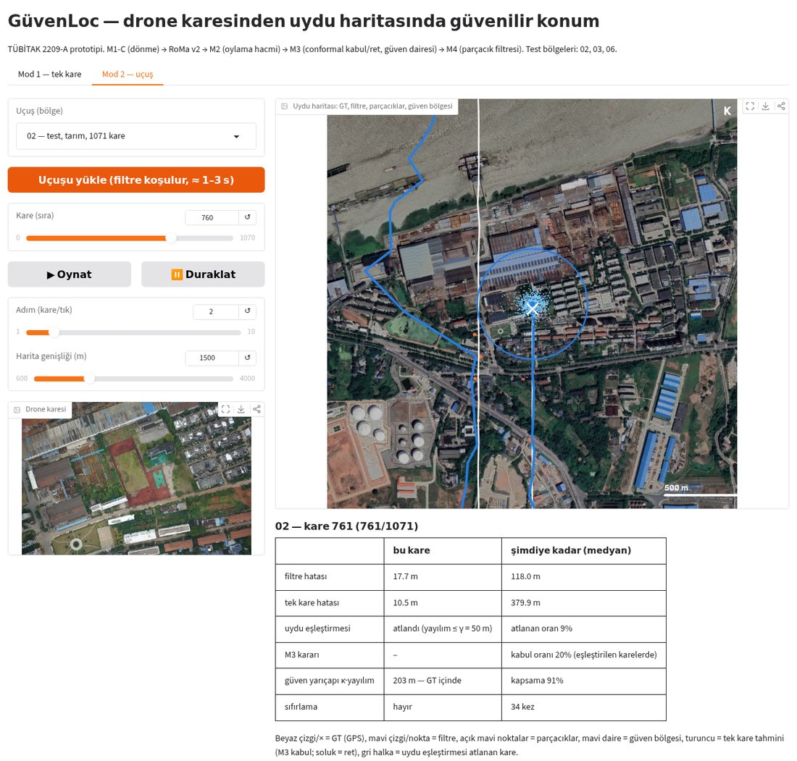
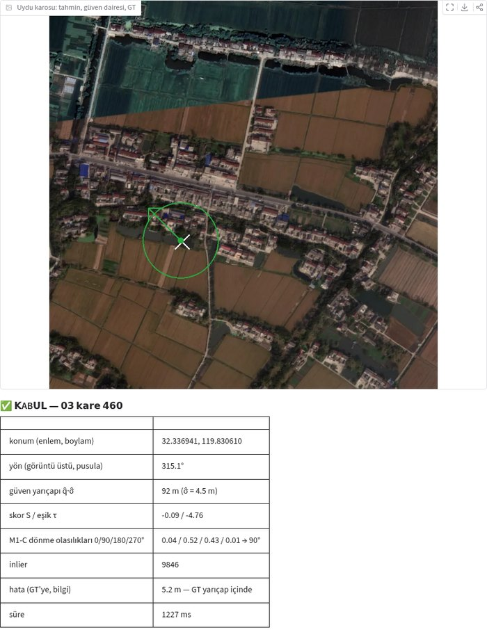
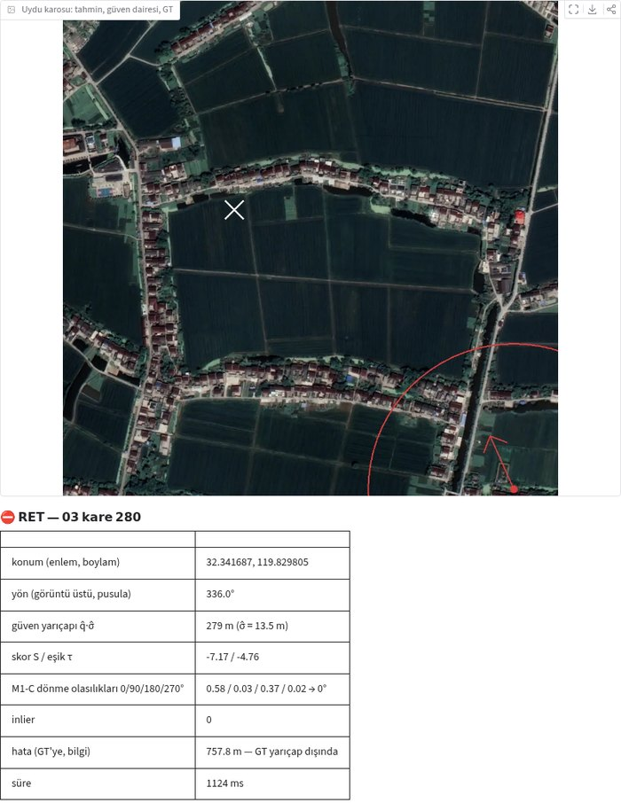

# GüvenLoc

**Drone karesinden uydu haritasında konum ve yön — ve sistemin ne zaman emin olmadığını söyleyen bir güven ölçüsü.**

TÜBİTAK 2209-A araştırma projesi · [UAV-VisLoc](https://github.com/IntelliSensing/UAV-VisLoc) veri kümesi · MIT lisanslı kod



*Prototipte bir test uçuşu (bölge 02, kare 761). Beyaz: GPS yörüngesi; mavi: parçacık filtresinin kestirimi ve güven
dairesi; açık mavi noktalar: parçacıklar. Bu karede filtre hatası 17,7 m.*

## Ne yapıyor?

GPS olmadan uçan bir drone'un kamerasındaki kareyi, kuzeyi yukarı bakan uydu görüntüsüyle eşleştirip drone'un nerede
olduğunu ve hangi yöne baktığını bulur. Her adım bir modül:

| Adım | Modül | Ne yapar |
|---|---|---|
| 1 | **M1-C** — yön tahmini | Drone karesinin uyduya göre kabaca kaç derece döndüğünü (0/90/180/270°) tahmin eder, eşleştiriciyi doğru açıyla çağırır |
| 2 | **RoMa v2** — eşleştirici | Drone karesiyle uydu karosu arasında yoğun nokta eşleşmeleri bulur (önceden eğitilmiş, değiştirilmeden kullanılır) |
| 3 | **M2** — oylama hacmi | Eşleşmelerden konum ve yön için bir olasılık haritası kurar; tepe noktası tahmin, yayılımı belirsizlik olur |
| 4 | **M3** — conformal kabul/ret | Skor eşiğin altındaysa "eşleşme yok" der; kabul edilen her tahmine %90 hedefli bir güven dairesi çizer |
| 5 | **M4** — parçacık filtresi | Ardışık kareler arasındaki hareketi kullanarak tek kare hatalarını süzer, yörüngeyi düzgünleştirir |

## Sonuçlar

Dört hipotez veriye bakılmadan önce ölçütleriyle kaydedildi ve test bölgelerinde (02, 03, 06) **yalnızca bir kez**
değerlendirildi; ölçütler sonradan değiştirilmedi. Ayrıntı: [docs/faz6_test.md](docs/faz6_test.md).

| Hipotez | Ölçüt | Test sonucu | |
|---|---|---|---|
| **H4** filtre | medyan hatada ≥ %20 azalma, kapsama ≥ 0,88 | **208 → 28 m (−%86,5)**, kapsama 0,906 | ✓ |
| **H1** yön tahmini | medyan yön hatası ≤ 10° | 82,4° (kalibrasyonda 8,9°) | ✗ |
| **H2** ret skoru | inlier sayısı skoruna göre daha az yanlış kabul | daha fazla yanlış kabul | ✗ |
| **H3** conformal | yanlış kabul ≤ 0,05, kapsama ≥ 0,88 | 0,088 ve 0,875 | ✗ |

Ablasyon (test, 2.177 pozitif kare; tam tablo [ablation_test.md](docs/sonuclar/faz6/ablation_test.md)):

| Sistem | Başarı (≤ 25 m, kabul edilmiş) | Medyan hata | Eşleştirici çağrısı/kare |
|---|---|---|---|
| RoMa v2 + RANSAC (taban) | 0,352 | 298 m | 1 |
| 4 yönü dene, en iyisini seç | 0,399 | 37 m | 4 |
| + M1-C yön tahmini | 0,377 | 120 m | 2,05 |
| + M2 + M3 (tek kare, güvenli) | 0,352 | 208 m | 1 |
| **+ M4 filtre (tam sistem)** | **0,451** | **28 m** | 1 |

Hız (RTX 3090): tam sistem ≈ 684 ms/kare, en çok **3,6 GB GPU belleği** — 8 GB'lık bir kartta çalışır.

## Demo

```bash
python app/app.py            # http://127.0.0.1:7860 — ilk açılış ≈ 10 s
```

Uzak bir sunucuda çalışıyorsa: `ssh -L 7860:127.0.0.1:7860 kullanici@sunucu`, sonra tarayıcıda aynı adres.

**Mod 1 — tek kare:** bölge ve kare seç (ya da kendi drone görüntünü yükle), *Konumlandır*'a bas. Uydu karosunda
tahmin, yön oku, güven dairesi ve GPS konumu çizilir.

| Kabul: hata 5 m, GPS dairenin içinde | Ret: tahmin 758 m uzakta, sistem "eşleşme yok" diyor |
|---|---|
|  |  |

**Mod 2 — uçuş:** bölge seç, *Uçuşu yükle*, *▶ Oynat*. Haritada GPS ve filtre yörüngesi, parçacık bulutu, güven
dairesi ve uydu eşleştirmesinin atlandığı kareler görünür (yukarıdaki görsel).

<sub>Ekran görüntülerindeki drone kareleri ve uydu haritaları UAV-VisLoc veri kümesindendir (Xu vd., 2024; uydu
haritaları Google Maps kaynaklı) ve yalnız tanıtım amacıyla, atıfla gösterilmiştir.</sub>

## Kurulum

Linux, Python 3.12, CUDA'lı NVIDIA GPU (≥ 8 GB önerilir).

```bash
python3.12 -m venv .venv && source .venv/bin/activate
pip install torch==2.11.0 torchvision==0.26.0 --index-url https://download.pytorch.org/whl/cu128
pip install -r requirements.txt
python scripts/00_check_env.py                         # ortam denetimi
python -m pytest -q                                    # testler
```

İlk çalıştırma RoMa v2 ağırlıklarını (≈ 1 GB) ve DINOv3 kodunu `~/.cache/torch/hub` altına indirir.

## Veri ve sürüm paketi

1. **UAV-VisLoc** (16,4 GB, Google Drive sürümü): `bash scripts/10_download_data.sh` yönergesiyle
   `data/UAV_VisLoc_dataset/` altına; doğrulama `python scripts/11_verify_data.py data/UAV_VisLoc_dataset --expect-frames 6774 --expect-maps 11 --checksums`.
2. **Sürüm paketi** `guvenloc-v1.0-paket.tar.gz` (≈ 145 MB; görüntü içermez; UAV-VisLoc yazarlarının onayından sonra
   GitHub Release eki olarak yayımlanacak, F6-6): M1-C ağırlıkları,
   çift listesi, M1 etiketleri, M3 parametreleri. `python scripts/95_release.py --unpack guvenloc-v1.0-paket.tar.gz`
   sha256'ları doğrular ve dosyaları yerlerine koyar. Paket bu depodan `python scripts/95_release.py` ile üretilir.

## Tabloları yeniden üretme

Sıra önemlidir (her adım öncekinin çıktısını okur). Ağır adımların süresi RTX 3090'da verilmiştir.
Paketi açtıysanız M1 eğitimini (Faz 2) atlayabilirsiniz; çift listesi de pakettekiyle aynıdır.

| Faz | Komut | Çıktı / tablo |
|---|---|---|
| 1 veri | `python scripts/14_make_pairs.py data/UAV_VisLoc_dataset` | `data/pairs/pairs_v1.csv` (sha256 `docs/checksums/`) |
| 1 tekrarlama | `python scripts/20_repro_mega1500.py --data data/megadepth --seeds 0 1 2 3 4` (`--c4` ile C4); `python scripts/21_repro_wxbs.py --seeds 0 1 2 3 4` | [docs/faz1_tekrarlama.md](docs/faz1_tekrarlama.md) |
| 1 önbellek | `python scripts/30_build_cache.py data/UAV_VisLoc_dataset --split {train,calib,test}` ve `--seq`; `python scripts/31_verify_cache.py cache/v1` (≈ 10 saat) | `cache/v1` (RoMa v2 eşleşmeleri) |
| 1 taban çizgisi | `python scripts/40_baselines.py feats --cache cache/v1 --split train --ransac-px 3 5 8` (ve calib), `select`, `eval --split calib`; `python scripts/42_sigma_scale.py --cache cache/v1` | satır 1–3, `configs/baselines.yaml` |
| 2 M1 | `python scripts/50_m1_labels.py --cache cache/v1`; `51_m1_prep.py`; `54_m1c_prep.py --gercek --ek 3`; `bash scripts/55_m1c_v2_zincir.sh` (`55_m1c_train.py --veri gercek4 --epochs 12 --batch 32`, sonra `--only D2_olcek_rot90 --seeds 1 2`); her tohum için `56_m1c_roma.py --model D2_olcek_rot90[_s1,_s2] --sec`; `57_m1c_2e.py`; `58_m1c_ens.py` | [docs/faz2_m1.md](docs/faz2_m1.md) |
| 3 M2 | `python scripts/60_m2_features.py --splits train calib`; `python scripts/61_m2_score.py` | [docs/faz3_m2.md](docs/faz3_m2.md) |
| 4 M3 | `python scripts/64_m3_conformal.py`; `66_m3_decoy_pairs.py` + önbellek; `65_m3_decoy.py --real`; `67_m3_pipeline.py --export` | [docs/faz4_m3.md](docs/faz4_m3.md) |
| 5 M4 | `python scripts/70_m4_sequences.py`; `71_m4_measure.py`; `72_m4_filter.py --tune --dry --gamma --traj`; `73_m4_figures.py` | [docs/faz5_m4.md](docs/faz5_m4.md) |
| 6 test | `python scripts/80_final_prep.py`; `python scripts/81_freeze.py`; `python scripts/90_ablation.py --final` | [docs/faz6_test.md](docs/faz6_test.md) |
| 6 hız | `python scripts/91_speed.py --n 60` | [speed.md](docs/sonuclar/faz6/speed.md) |

**Test adımı hakkında:** `90_ablation.py --final`, `configs/final_manifest.json`'daki sha256'larla dondurulmuş
girdileri doğrular ve her değerlendirmeden sonra kilit bırakır (`guvenloc/final_guard.py`, F6-1). Kendi makinenizde
yeniden ürettiğiniz ara dosyalar bayt düzeyinde aynı olmayabilir; bu durumda önce `81_freeze.py` ile kendi
manifestinizi yazın. Bizim manifestimiz pakette `params/final_manifest.json` olarak durur. Aynı tablo kodunu
test bölgelerine dokunmadan denemek için: `python scripts/90_ablation.py --rehearse` (calib).

Testler: `python -m pytest -q` (GPU testleri CI'da atlanır).

## Depo yapısı

```
guvenloc/      kütüphane: veri okuma, coğrafya, eşleştirici, M1–M4, uçtan uca hat (pipeline.py)
scripts/       numaralı betikler — numara sırası çalıştırma sırasıdır (10 veri … 90 ablasyon)
app/           Gradio prototipi
configs/       bölge ayrımı, ön-kayıtlı hipotezler (h1–h4.yaml), test dondurma manifesti
docs/          faz raporları ve kararlar; docs/sonuclar/ sonuç tablolarının kopyaları
tests/         pytest
```

## Belgeler

| | Belge | Sürüm |
|---|---|---|
| Mimari, fazlar, kurallar | [MIMARI.md](MIMARI.md), modüller arası veri biçimleri [INTERFACES.md](INTERFACES.md) | |
| Faz 1 — veri, eşleştirici, önbellek, taban çizgileri | [faz1_durum.md](docs/faz1_durum.md), [faz1_tekrarlama.md](docs/faz1_tekrarlama.md) | v0.0 |
| Faz 2 — M1-C yön tahmini | [faz2_m1.md](docs/faz2_m1.md) | v0.1 |
| Faz 3 — M2 oylama hacmi, ret skoru | [faz3_m2.md](docs/faz3_m2.md) | v0.2 |
| Faz 4 — M3 conformal, uçtan uca hat | [faz4_m3.md](docs/faz4_m3.md) | v0.3 |
| Faz 5 — M4 parçacık filtresi | [faz5_m4.md](docs/faz5_m4.md) | v0.4 |
| Faz 6 — test, ablasyon, hız, prototip, açık kaynak | [faz6_test.md](docs/faz6_test.md) | v1.0 |

Her faz belgesinde karar tablosu (F*x*-*y*: ne, neden) ve sonuç tabloları var.

## Lisans ve atıf

Kod **MIT** ([LICENSE](LICENSE)); atıf bilgisi [CITATION.cff](CITATION.cff). Veri kümesi, RoMa v2 ve DINOv3 bu depoda
dağıtılmaz, kendi koşullarıyla edinilir: [THIRD_PARTY.md](THIRD_PARTY.md). UAV-VisLoc'un lisansı belirtilmediği için
depoda veri kümesinden yalnız yukarıdaki tanıtım ekran görüntüleri vardır; M1 ağırlıkları ve meta veri yalnız
araştırma amaçlıdır (F6-6).
